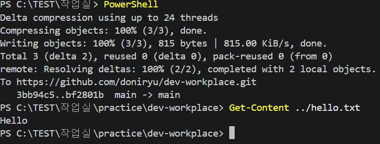
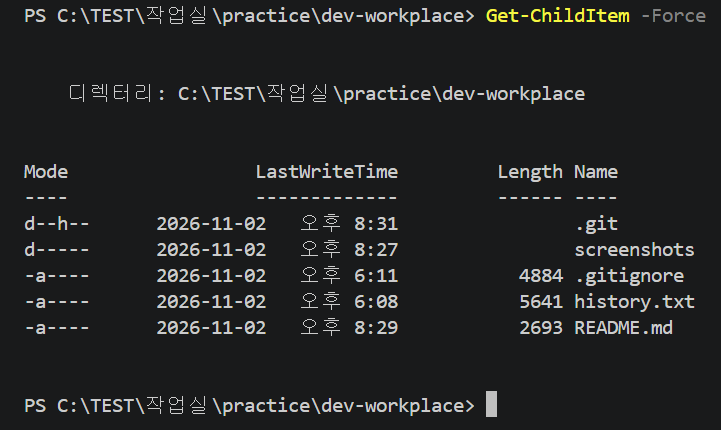

# dev-workplace
코디세이 1-1 프로젝트

## 진행 상황
Windows PowerShell에서 파일 만들기, 읽기, 복사, 이름 바꾸기, 이동, 삭제를 연습했다.
Git 설정을 완료하고 실습 명령어 기록을 GitHub에 올렸다


## 사용 환경
- 운영체제: Windows 11
- 편집기: Visual Studio Code
- 터미널: Windows PowerShell
- Git 버전: 2.56.0.windows.4
- Docker: 설치 및 실습 대기 중

## 터미널 실습 기록
파일과 폴더를 만들고, 복사하고, 이름을 바꾸고, 이동하고, 삭제하는 연습을 했다.

[입력한 명령어 기록 보기](history.txt)

## Git 상태 확인 화면


## 오류와 해결 과정

### Git 명령어 오타
- 문제: git ststus를 입력하니 명령어를 찾을 수 없다는 오류가 나왔다.
- 원인: status의 철자를 잘못 입력했다. 
- 해결: git status로 고쳐 입력했다.
- 결과: 현재 브랜치와 파일 변경 상태가 정상적으로 표시됐다. 

### Docker 설치 문제
- 문제: Docker Desktop 설치 중 Virtual Machine Platform 기능이 꺼져 있다는 오류가 나왔다.
- 확인한 내용: 설치 안내에 해당 기능을 켜려면 관리자 권한이 필요하다고 표시됐다.
- 진행 상황: 담당자에게 문의했으며, 서버 문제도 있다는 안내를 받았다. 아직 설치는 완료하지 못했다. 
- 다음 계획: 설치 가능한 환경이 준비되면 Docker 실습을 진행한다.

## 터미널 실습 따라 하기
Windows PowerShell에서 아래 명령어를 한 줄씩 입력한다.
실습할 위치에 practice 폴더가 없다면 다음 명령어로 만들고 들어간다.

    mkdir practice
    cd practice

파일을 만들고 내용을 저장한 뒤 확인한다.

    New-Item -Name hello.txt -ItemType File
    Set-Content hello.txt "Hello"
    Get-Content hello.txt

마지막 명령어를 실행하면 Hello가 표시된다.

파일을 복사하고 이름을 바꾼 뒤 폴더로 이동한다.

    Copy-Item hello.txt copy.txt
    Rename-Item copy.txt renamed.txt
    mkdir archive
    Move-Item renamed.txt archive
    Get-ChildItem archive

archive 폴더 안에 renamed.txt가 표시된다.

이동한 파일을 삭제한 다음 빈 폴더를 삭제한다.

    Remove-Item archive/renamed.txt
    Remove-Item archive
    Get-ChildItem

이 순서대로 실습했다면 practice 폴더에는 hello.txt만 남는다.

## 파일 내용 확인 화면
hello.txt에 저장한 Hello가 출력되는 것을 확인했다.



## 숨김 항목을 포함한 목록 확인
Get-ChildItem -Force를 실행하여 숨김 폴더인 .git까지 확인했다.



## macOS 권한 연습
연습용 폴더와 파일에 chmod를 적용하고 변경 전후를 확인했다.

- r: 읽기, w: 쓰기, x: 실행(폴더에서는 접근)
- 폴더: 755 → 700 → 755
- 파일: 644 → 600 → 644
- 700·600은 소유자만 접근하도록 제한한 설정이다.
- 이번 연습은 macOS에서 진행했으며, Linux에서도 추가 확인할 예정이다.

[권한 변경 결과](permission-practice/permissions-log.txt)

## Linux 권한 실습
Docker의 Ubuntu 24.04 안에서 파일과 폴더의 권한을 변경했다.

- 폴더: 755 → 700 → 755
- 파일: 644 → 600 → 644
- 변경 전, 제한한 상태, 복원한 상태를 기록했다.

[Linux 권한 변경 결과](linux-practice/permissions-log.txt)

## Docker 실습 결과
Dockerfile로 my-web 이미지를 만들고 웹페이지를 실행했다.

- 8080번과 8081번 포트에서 각각 웹페이지 접속을 확인했다.
- logs로 실행 기록, stats로 CPU와 메모리 사용량을 확인했다.
- 컨테이너를 중지한 뒤 다시 시작했다.
- 8082번에서는 바인드 마운트로 index.html 수정 내용이 반영되는 것을 확인했다.
- diary-data 볼륨에 저장한 문장이 컨테이너 삭제 후에도 남는 것을 확인했다.

### 실행 기록
- [Docker 버전](docker-practice/version.txt)
- [Docker 환경 정보](docker-practice/info.txt)
- [컨테이너 목록](docker-practice/containers.txt)
- [웹 서버 로그](docker-practice/web-logs.txt)
- [자원 사용량](docker-practice/stats.txt)
- [바인드 마운트 설정](docker-practice/bind-mount.txt)
- [볼륨 데이터 확인](docker-practice/volume-result.txt)

## 웹페이지 실행 방법
Docker Desktop을 실행한 상태에서 터미널에 입력한다.

```
git clone https://github.com/doniryu/dev-workplace.git
cd dev-workplace
docker build -t my-web .
docker run -d --name diary-demo -p 8090:80 my-web
```

브라우저에서 http://localhost:8090 으로 접속한다.

실습을 마치면 아래 명령으로 중지하고 삭제한다.

```
docker stop diary-demo
docker rm diary-demo
```
