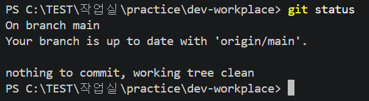

# dev-workplace
코디세이 1-1 프로젝트

## 진행 상황
Windows PowerShell에서 파일 만들기, 읽기, 복사, 이름 바꾸기, 이동, 삭제를 연습했다.
Git 설정을 완료하고 실습 명령어 기록을 GitHub에 올렸다

## 사용 환경
- 운영체제: Windows 11
- 편집기: Visual Studio Code
- 터미널: Windows PowerShell
- Git 버전: 2.56.0.windows.4
- Docker: 설치 및 실습 대기 중

## 터미널 실습 기록
파일과 폴더를 만들고, 복사하고, 이름을 바꾸고, 이동하고, 삭제하는 연습을 했다.

[입력한 명령어 기록 보기](history.txt)

## Git 상태 확인 화면

## 오류와 해결 과정

### Git 명령어 오타
- 문제: git ststus를 입력하니 명령어를 찾을 수 없다는 오류가 나왔다.
- 원인: status의 철자를 잘못 입력했다. 
- 해결: git status로 고쳐 입력했다.
- 결과: 현재 브랜치와 파일 변경 상태가 정상적으로 표시됐다. 

### Docker 설치 문제
- 문제: Docker Desktop 설치 중 Virtual Machine Platform 기능이 꺼져 있다는 오류가 나왔다.
- 확인한 내용: 설치 안내에 해당 기능을 켜려면 관리자 권한이 필요하다고 표시됐다.
- 진행 상황: 담당자에게 문의했으며, 서버 문제도 있다는 안내를 받았다. 아직 설치는 완료하지 못했다. 
- 다음 계획: 설치 가능한 환경이 준비되면 Docker 실습을 진행한다.